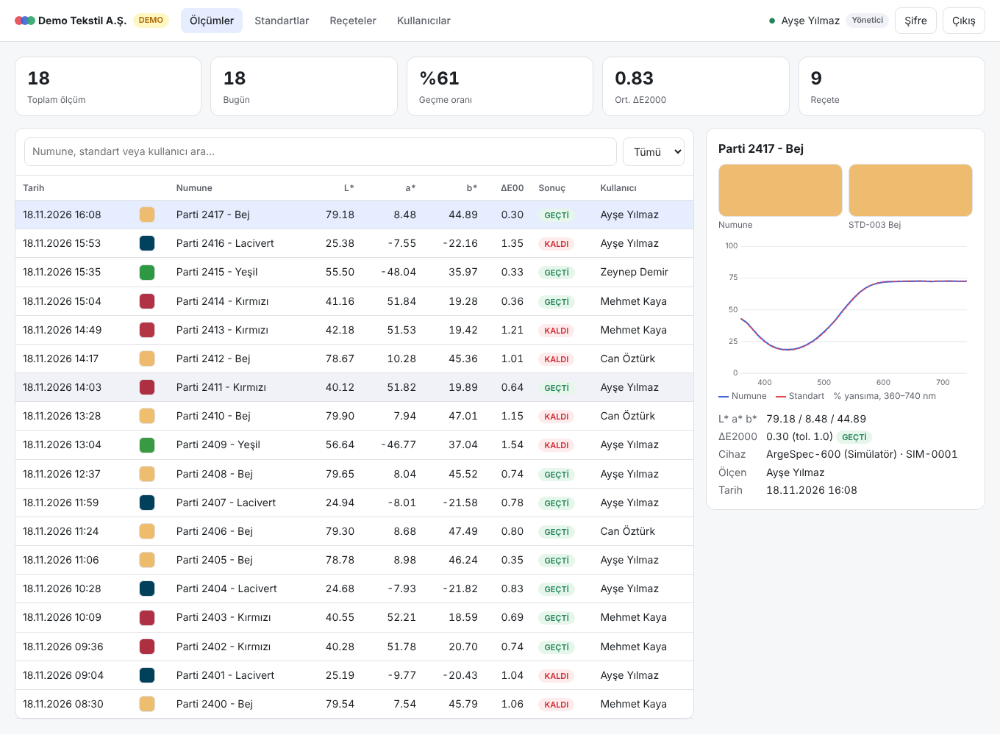
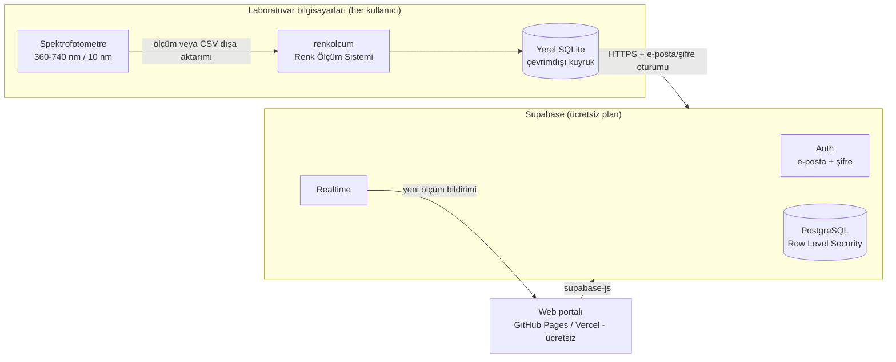
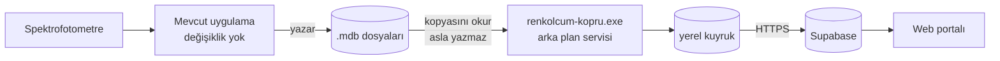

# Renk Ölçüm Bulutu (Dummy Proje)

Spektrofotometre ile alınan renk ölçümlerini ve reçeteleri **10 kullanıcının şifreyle eriştiği ortak bir bulut veritabanında** toplayan örnek sistem. Tamamen **ücretsiz** servislerle kurulur.

> Renk ölçüm yazılımı ve cihaz bu projede **simüledir** (dummy). Cihaz 360–740 nm arasında 10 nm aralıklarla **39 noktalık % yansıma** verisi üretir. Gerçek sisteme geçerken yalnızca `renkolcum/spectro.py` içindeki sürücü katmanı değişir.



## Mimari



| Katman | Ücretsiz servis | Görevi |
|---|---|---|
| Veritabanı + Kimlik doğrulama + Realtime | **Supabase Free** (500 MB DB, 50.000 aylık aktif kullanıcı) | Ortak ölçüm/standart/reçete veritabanı, kullanıcı girişi, RLS ile yetki |
| Web portalı | **GitHub Pages** veya **Vercel Hobby** / Netlify | Kullanıcıların tarayıcıdan ölçümleri, standartları ve reçeteleri görmesi |
| Masaüstü ölçüm yazılımı | — (Python, yerelde çalışır) | Cihazdan veri al, L\*a\*b\* / ΔE2000 hesapla, reçete öner, buluta gönder |

> Not: Supabase ücretsiz planında proje 7 gün hiç kullanılmazsa duraklatılır; Dashboard'dan tek tıkla tekrar açılır. Ücretsiz planda organizasyon başına en fazla 2 aktif proje vardır.

## Mevcut masaüstü uygulamasını buluta bağlama (.mdb köprüsü)

Kaynak koduna erişilemeyen hazır bir Windows uygulaması için **uygulamaya dokunmadan** çalışan yol budur. Uygulama ölçümü yaptığında `.mdb` (Access) dosyasına yazar; köprü bu dosyayı izler ve yeni/değişen kayıtları buluta gönderir.



**Nasıl çalışır**
1. Klasördeki `*.mdb` dosyaları birkaç saniyede bir kontrol edilir (değişiklik tarihi + boyut).
2. Değişen dosyanın yazımı bitene kadar beklenir (`--bekle`, varsayılan 3 sn), sonra **geçici bir kopyası** okunur. Uygulamanın açık tuttuğu dosya kilitlenmez, değiştirilmez.
3. `esleme.json` hangi tablonun/kolonun ne olduğunu söyler. `mdb-kesfet` bunu otomatik önerir.
4. Her satıra dosya adı + tablo + anahtar kolondan **sabit bir kimlik** üretilir: aynı satır asla iki kez gönderilmez (bilgisayar yeniden kurulsa bile).
5. Satır sonradan değişirse (ör. uygulama analiz sonucunu sonradan yazdıysa) buluttaki kayıt **güncellenir**.
6. Uygulamanın kendi hesapladığı L\*a\*b\* / ΔE değerleri kullanılır; yoksa spektrumdan hesaplanır. Eşlenmeyen tüm kolonlar `meta.ham` içinde saklanır, veri kaybolmaz.
7. İnternet yoksa kayıtlar bilgisayarda bekler.

Desteklenen yapılar: tek dosyada biriken ölçümler veya **her ölçüm için ayrı .mdb dosyası**. Spektrum üç şekilde olabilir:

| `spektrum.tip` | .mdb'deki yapı | Örnek |
|---|---|---|
| `genis` | Her dalga boyu bir kolon | `R360, R370, … R740` |
| `uzun` | Ayrı tabloda satır satır | `SPEKTRUM(OLCUM_NO, DALGA_BOYU, YANSIMA)` |
| `metin` | Tek kolonda ayraçlı değerler | `"12.3;11.9;…"` + `baslangic`, `adim` |

Değerler 0–1 arasındaysa `olcek: 100`; 360–740 dışı aralıklar (ör. 400–700) otomatik olarak 360–740 / 10 nm ızgarasına çevrilir.

**Örnek `esleme.json`**
```json
{
  "tablo": "OLCUMLER",
  "anahtar": ["OLCUM_NO"],
  "alanlar": {
    "sample_name": "NUMUNE_ADI", "measured_at": "TARIH", "operator_name": "OPERATOR",
    "l_star": "L_DEG", "a_star": "A_DEG", "b_star": "B_DEG",
    "delta_e2000": "DE2000", "pass_fail": "SONUC", "standard_name": "STANDART"
  },
  "spektrum": {"tip": "genis", "kolonlar": {"360": "R360", "370": "R370", "...": "...", "740": "R740"}},
  "olcek": 1.0,
  "saat_dilimi": "Europe/Istanbul",
  "kaynak": "LAB1"
}
```

**Windows kurulumu (Python gerekmez)**: `.github/workflows/windows-exe.yml` her push'ta `renkolcum.exe` (komut satırı) ve `renkolcum-kopru.exe` (pencere açmayan servis) dosyalarını ücretsiz GitHub Actions üzerinde derler; Actions → *RenkOlcum-Windows* artifact'ından indirilir. Adımlar `windows/KURULUM.txt` içinde:

```powershell
renkolcum.exe ayar --url https://xxxx.supabase.co --anahtar <anon-key>
renkolcum.exe giris --email lab1@firma.com
renkolcum.exe mdb-kesfet "C:\UygulamaVeri\olcumler.mdb" --yaz esleme.json --kaynak LAB1
renkolcum.exe mdb-izle "C:\UygulamaVeri" --esleme esleme.json --tek-sefer    # deneme
.\kur.ps1 -Klasor "C:\UygulamaVeri" -Esleme "C:\RenkOlcum\esleme.json"       # açılışta otomatik başlat
```

Okuyucular: varsayılan saf Python okuyucu (sürücü gerektirmez). `.mdb` **şifreliyse** *Microsoft Access Database Engine* kurulup `--okuyucu odbc --sifre ...` kullanılır.

## Proje yapısı

```
renkolcum/            Renk Ölçüm Sistemi (Python paketi, `renkolcum` komutu)
  spectro.py          Simüle spektrofotometre + cihaz CSV okuyucu
  colorimetry.py      Yansıma → XYZ → CIELAB (D65/10°), ΔE*ab, ΔE2000
  kubelka_munk.py     Kubelka-Munk modeli + dummy boyarmadde kütüphanesi
  recipe.py           Reçete hesaplama (1-3 boyarmadde, ΔE2000'e göre en iyi)
  cloud.py            Supabase istemcisi (Auth + REST)
  store.py            Yerel SQLite: çevrimdışı kuyruk + önbellek
  mdb_bridge.py       Mevcut uygulamanın .mdb dosyalarını buluta taşıyan köprü
  service.py, cli.py  İş mantığı ve komut satırı
supabase/
  migrations/         Veritabanı şeması + RLS politikaları + 10 kullanıcı limiti
  seed.sql            Boyarmaddeler ve örnek renk standartları
  tests/              Yerel PostgreSQL üzerinde RLS testleri
windows/              Windows exe girişleri, kur.ps1, KURULUM.txt
web/                  Web portalı (statik HTML/JS, demo modu dahil)
scripts/              Kullanıcı oluşturma, seed / demo veri üreticileri
tests/                pytest testleri (uçtan uca bulut senkronu dahil)
  mdb/                Test .mdb dosyaları (Jet4) ve üretici (Java + Jackcess)
```

## Veritabanı

| Tablo | İçerik |
|---|---|
| `profiles` | Kullanıcılar: ad, e-posta, rol (`admin` / `operator` / `viewer`) |
| `app_settings` | Firma adı, **`max_users = 10`** |
| `measurements` | Ölçümler: 39 noktalı yansıma dizisi, L\*a\*b\*, standarda göre ΔE2000, GEÇTİ/KALDI, cihaz, ölçen kişi |
| `standards` | Müşteri renk standartları (referans eğri + tolerans) |
| `recipes` | Reçeteler: bileşenler (boyarmadde + %), tahmini ΔE, durum (taslak/onaylı), versiyon |
| `colorants` | Boyarmadde kütüphanesi (K/S eğrileri) — reçete hesabının ortak verisi |
| `instruments` | Cihaz kayıtları |

**Yetkiler (Row Level Security):**
- Giriş yapmamış (anonim) kimse hiçbir veriyi göremez.
- Sistemdeki tüm kullanıcılar ortak veriyi **okur** (ortak reçete veritabanı).
- `operator` ölçüm/standart/reçete ekler; yalnızca **kendi** kaydını düzenler/siler.
- `admin` her kaydı düzenler, reçete onaylar, boyarmaddeleri ve kullanıcı rollerini yönetir.
- `viewer` sadece okur.
- 11. kullanıcı oluşturulmaya çalışılırsa veritabanı reddeder (`max_users`).
- Spektrum 39 nokta değilse veya değerler 0–200 % dışındaysa kayıt reddedilir.
- Çevrimdışı alınan ölçümler `client_uuid` ile gönderilir; tekrar gönderilse bile çift kayıt oluşmaz.

## Kurulum (ücretsiz)

### 1. Supabase projesi
1. <https://supabase.com> → ücretsiz hesap → **New project** (bölge: `eu-central-1` Frankfurt önerilir).
2. **SQL Editor**'da sırasıyla çalıştırın:
   - `supabase/migrations/20261118000000_renk_olcum_init.sql`
   - `supabase/seed.sql`
3. **Authentication → Sign In / Providers**: *Allow new users to sign up* seçeneğini **kapatın** (kullanıcıları sadece admin ekler).
4. **Project Settings → API Keys**: `Project URL` ve `anon` / `publishable` anahtarını not edin.

### 2. Kullanıcıları ekleyin (en fazla 10)
- Dashboard → **Authentication → Users → Add user** (e-posta + şifre, "Auto confirm" işaretli), **veya**
- toplu olarak (service_role anahtarı yalnızca yönetici bilgisayarında kullanılmalı):
  ```bash
  export SUPABASE_URL=https://xxxx.supabase.co
  export SUPABASE_SERVICE_ROLE_KEY=...
  python scripts/create_users.py scripts/kullanicilar.ornek.csv
  ```
İlk oluşturulan kullanıcı otomatik **admin** olur.

### 3. Web portalı
`web/config.js` dosyasına URL ve anon anahtarı yazın, sonra birini seçin:
- **GitHub Pages:** repo → Settings → Pages → Source: *GitHub Actions*. `main`'e push edildiğinde `.github/workflows/pages.yml` yayınlar.
- **Vercel / Netlify:** yeni proje → kök klasör `web` → build komutu yok.

`config.js` boşsa portal **demo modunda** açılır (örnek veriyle, herhangi bir e-posta/şifre ile). Yerelde denemek için:
```bash
cd web && python -m http.server 8000   # http://localhost:8000
```

### 4. Renk Ölçüm Sistemi (her laboratuvar bilgisayarı)
```bash
pip install -e .
renkolcum ayar --url https://xxxx.supabase.co --anahtar <anon-key> --cihaz-seri SIM-0001
renkolcum giris --email lab1@firma.com          # şifre sorulur
renkolcum cihaz                                  # spektrofotometreyi algıla
renkolcum standartlar                            # ortak standart listesi
renkolcum olc --ad "Parti 2401" --numune kirmizi --standart STD-001
renkolcum recete son                             # son ölçümden reçete hesapla ve buluta kaydet
renkolcum listele --bulut                        # tüm kullanıcıların ölçümleri
```

Cihazın dışa aktardığı CSV dosyalarını otomatik algılamak için:
```bash
renkolcum izle C:\Cihaz\Export --standart STD-002
```
Klasöre düşen her `*.csv` okunur, L\*a\*b\*/ΔE hesaplanır, buluta gönderilir ve `islenen/` klasörüne taşınır.

CSV formatı (virgül veya noktalı virgül):
```
# Numune: Parti 2401
# Cihaz: ArgeSpec-600 SIM-0001
nm,R%
360,12.345
370,11.902
...
740,61.004
```

**İnternet yoksa** ölçümler yerel kuyruğa yazılır; `renkolcum senkron` veya bir sonraki ölçümde otomatik gönderilir.

| Komut | Açıklama |
|---|---|
| `ayar` | Supabase URL / anahtar / cihaz seri no |
| `giris`, `cikis`, `durum` | Oturum ve kuyruk durumu |
| `cihaz` | Cihazı algıla |
| `olc` | Ölçüm al (`--numune`: beyaz, kirmizi, bordo, turuncu, sari, yesil, mavi, lacivert, mor, gri, bej) |
| `izle KLASOR` | Cihaz CSV klasörünü izle |
| `senkron` | Bekleyenleri gönder |
| `listele [--bulut]` | Yerel / ortak ölçümler |
| `recete ID\|son` | Reçete hesapla (`--standarda-gore`, `--kaydetme`) |
| `standartlar`, `standart-ekle` | Renk standartları |
| `mdb-kesfet DOSYA` | Uygulamanın .mdb yapısını incele, `esleme.json` öner |
| `mdb-izle KLASOR` | .mdb köprüsü: yeni/değişen ölçümleri buluta gönder |

## Testler

```bash
pip install -e ".[test,mdb]" "psycopg[binary]"
pytest -q                          # 38 test: kolorimetri, reçete, RLS, uçtan uca senkron, .mdb köprüsü
bash supabase/tests/run_local.sh   # SQL şeması + RLS senaryoları (yerel PostgreSQL gerekir)
```

Uçtan uca testler `tests/fake_supabase.py` ile Supabase Auth/REST API'sini taklit eder; arkada gerçek PostgreSQL ve gerçek RLS politikaları çalışır.

## Gerçek sisteme geçiş notları
- `SimulatedSpectrophotometer` yerine gerçek cihazın SDK'sı / seri port protokolü ile aynı `Reading` nesnesini üreten bir sürücü yazılır.
- `colorants.ks` alanına gerçek boyarmadde kalibrasyon (K/S) verileri girilir.
- Kolorimetri 10 nm veriyle doğrudan çarpım yöntemini kullanır; üretimde ASTM E308 ağırlık tabloları tercih edilebilir.
